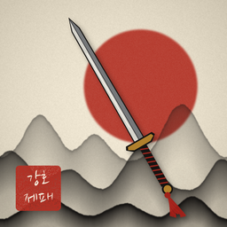
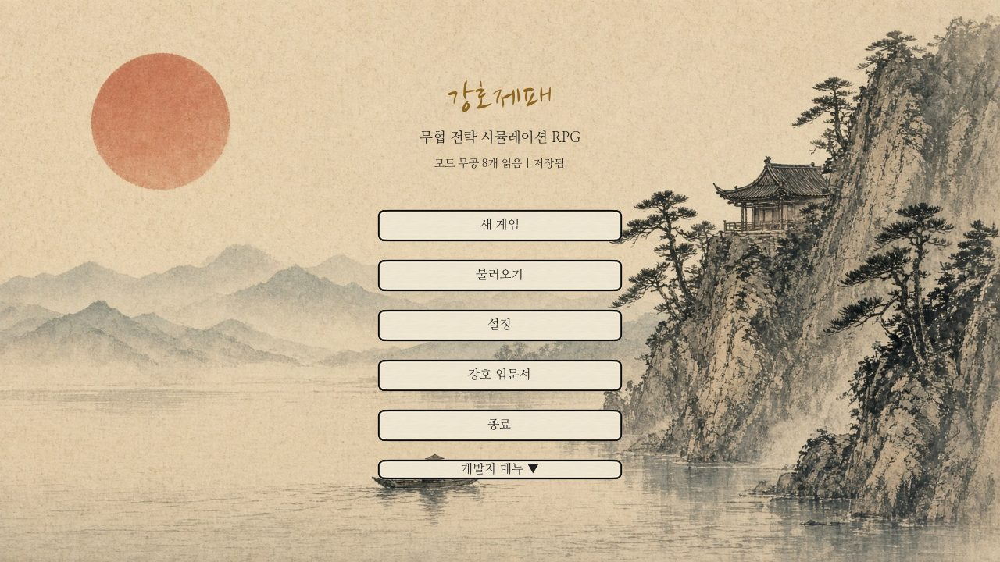
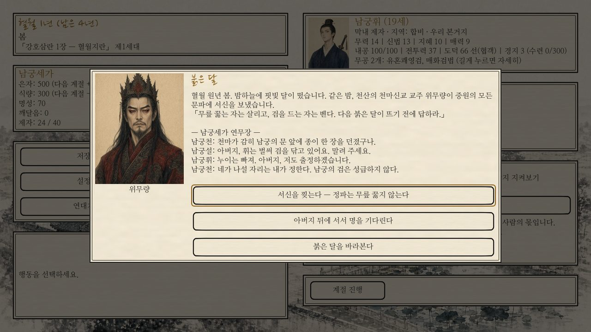
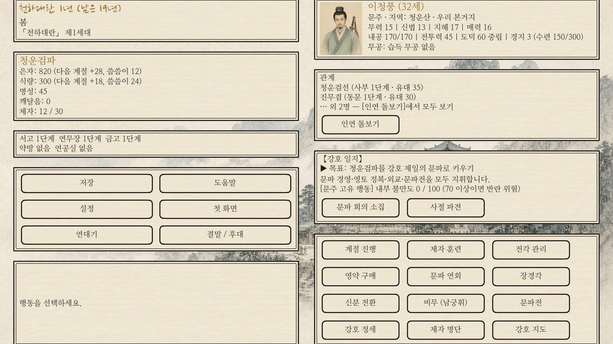
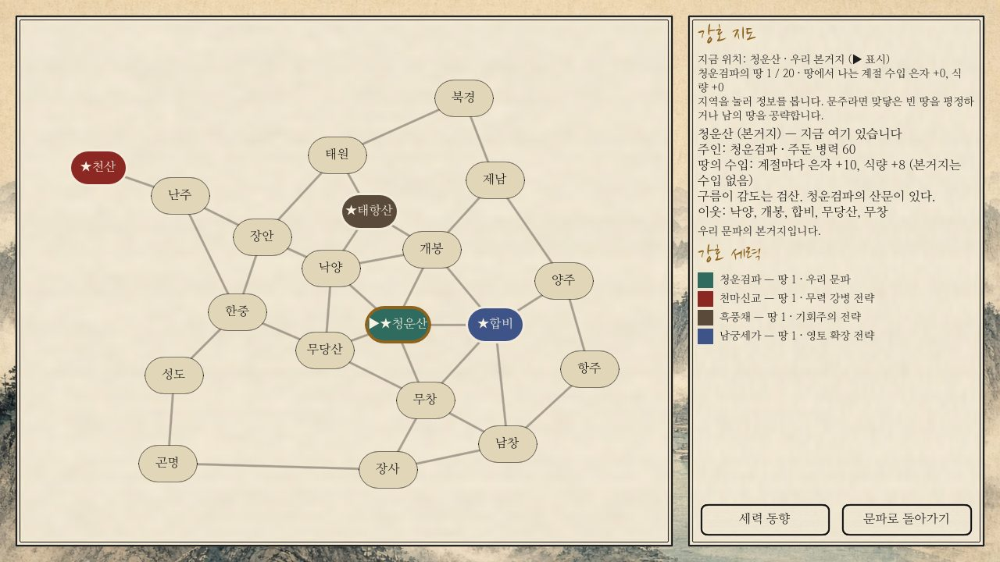
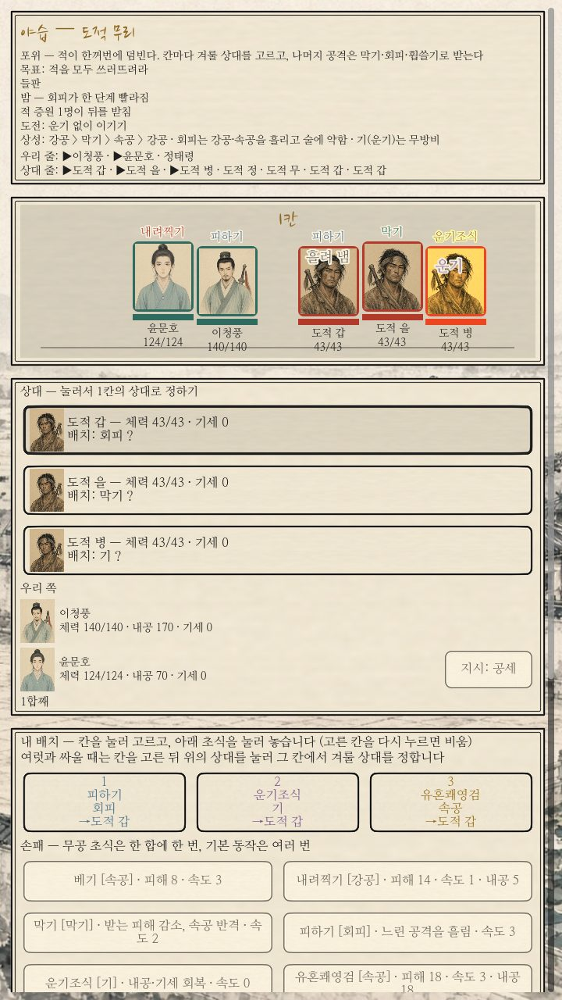
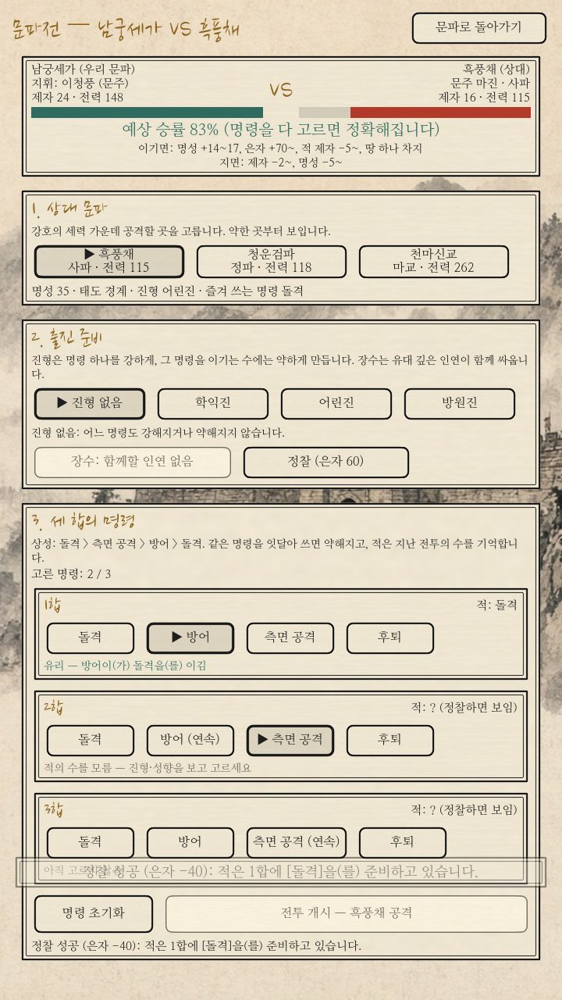
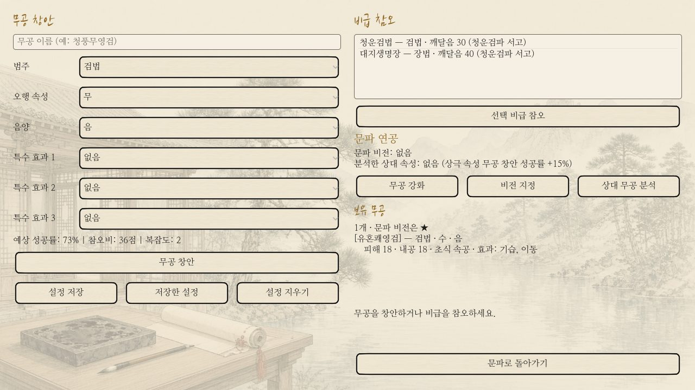

<p align="center">
  
</p>

<h1 align="center">강호제패</h1>

<p align="center">
  수묵담채로 그린 강호에서 문파를 일으키고, 초식을 겨루고, 정·사·마 백 년의 대란을 겪는 <b>무협 전략 시뮬레이션 RPG</b>
</p>

<p align="center">
  <a href="https://soulfactorx.github.io/StrongholdEmpire/"><b>▶ 웹에서 바로 하기</b></a> ·
  <a href="docs/기기_테스트_안내.md">휴대폰·PC에 설치하기</a> ·
  <a href="docs/강호제패_전체_게임_디자인_문서.md">게임 디자인 문서</a>
</p>

<p align="center">
  <a href="https://github.com/soulfactorx/StrongholdEmpire/releases/latest"></a>
  <a href="https://github.com/soulfactorx/StrongholdEmpire/actions/workflows/smoke_test.yml"></a>
  <a href="https://github.com/soulfactorx/StrongholdEmpire/actions/workflows/export.yml"></a>
  
  
</p>

<p align="center">
  
  
</p>

---

## 어떤 게임인가

계절마다 한 번씩 문파를 꾸리고, 사람을 만나고, 기연을 겪으며 한 무인의 일생을 보냅니다.
문주가 되어 문파를 강호 제일로 키울 수도, 낭인으로 떠돌며 이름을 떨칠 수도, 간자나 자객으로 그림자 속에 살 수도 있습니다.
선택은 문파의 살림과 인연, 그리고 강호의 판도를 바꾸고 이야기는 스무 가지가 넘는 결말 가운데 하나로 끝납니다.

- **초식 배치 대결** — 한 합마다 칸에 초식을 놓고 동시에 펼칩니다. 강공 > 막기 > 속공 > 강공, 회피와 술(術), 내공과 기세를 읽어야 이깁니다.
  상대의 버릇을 기억하고, 절초를 받아 내면 그 무공을 배웁니다. 합마다 무대에서 달려들고 맞고 흘려 내는 모습이 보입니다.
- **여러 형식의 싸움** — 일대일 비무, 연전, 포위, 진형전, 추격, 잠입, 대치, 비무대회. 다리 위·빙판·독무 같은 전장과 날씨, 도중의 사건과 도전 과제가 있습니다.
- **문파 경영** — 전각(서고·연무장·금고·약방·연공실)을 넓히고, 제자를 배치·수련·전수하고, 연회와 외교로 세를 키웁니다.
  행동마다 문파 사람들과 주고받는 대화 장면이 이어집니다.
- **신분과 갈림길** — 막내 제자·총관·문주·낭인·청부객·간자·자객. 조건을 채우면 신분을 바꾸고, 이적하고, 배신하고, 문파를 세웁니다.
- **강호 지도와 세력** — 스무 고을의 지도에서 땅을 평정하고 공략합니다. 세력들은 저마다의 전략으로 자라고 서로 싸우며 당신을 노립니다.
- **기연과 인연** — 250개 가까운 기연, 스승·벗·혈맹·연인·원수로 변해 가는 인연, 지난 선택을 기억하는 대사.
- **장경각** — 범주·오행·음양·묘리를 조합해 나만의 무공을 창안하고, 비급을 참오하고, 문파 비전을 후대에 물려줍니다.

<p align="center">
  
  
</p>
<p align="center">
  
  
  
</p>

## 시나리오

| 시나리오 | 길이 | 내용 |
|---|---|---|
| **입문 수련** | 4년 | 처음이라면 여기서. 길잡이를 따라 경영·전투·무공·인연·외교·문파전을 차례로 익힙니다. |
| **천하대란** | 20년 | 표준 시나리오. 정파·사파·마교가 얽힌 강호에서 자신만의 이야기를 완성합니다. 세대 전승이 있습니다. |
| **흑풍의 겨울** | 5년 | 세를 불린 흑풍채가 청운검파를 노립니다. 습격이 잦은 단기전. |
| **강호백년** | 제한 없음 | 대를 이어 문파를 키우는 긴 판. 열다섯 해 뒤 천마신교가 침공합니다. |
| **강호삼란 1장 — 혈월지란** | 5년 | 메인 이야기. 마교가 이기는 첫 대전. 남궁휘·연소화·진무겸·혈영 가운데 한 명으로. |
| **강호삼란 2장 — 흑련천하** | 5년 | 스물다섯 해 뒤, 사파가 이기는 두 번째 대전. 마화린·남궁휘·혈영·석운. |
| **강호삼란 3장 — 청천재명** | 5년 | 다시 스무 해 뒤, 정파가 이기며 백 년의 대란이 끝납니다. 청하·남궁연·독고결·위설아. |

메인 이야기 「강호삼란」은 장마다 네 명의 등장인물 가운데 한 명을 골라 그 사람의 눈으로 같은 대전을 겪습니다.
이야기를 따라 비무·장경각·지도·영약·외교가 하나씩 열리고, 강호 일지와 연표가 다음 갈림길을 알려 줍니다. 줄거리는 [메인 시나리오](docs/메인_시나리오.md)에 있습니다.

## 하는 법

[**최신 릴리스**](https://github.com/soulfactorx/StrongholdEmpire/releases/latest)에서 Android APK·Windows·Linux·웹 파일을 받을 수 있습니다.

| 플랫폼 | 방법 |
|---|---|
| 웹 (휴대폰·PC) | **https://soulfactorx.github.io/StrongholdEmpire/** — 홈 화면에 추가하면 앱처럼 쓸 수 있습니다. 소리는 화면을 한 번 누른 뒤에 납니다. |
| Android | 릴리스의 `…-android.apk` (arm64). 개발 중 빌드는 Actions → **내보내기** → `android-apk` 아티팩트 |
| Windows / Linux | 릴리스의 `…-windows.zip` / `…-linux.zip` |

한 번 설치한 Android·Windows·Linux 앱은 새 버전이 나오면 시작할 때 알려 주고, [업데이트]를 누르면 앱 안에서 받아 바꿉니다 ([앱 안 업데이트](docs/릴리스_안내.md#3-앱-안-업데이트-androidwindowslinux)).
자세한 설치와 기기 시험은 [기기 테스트 안내](docs/기기_테스트_안내.md)를 보세요.
휴대폰이 먼저입니다. 모든 기능을 터치만으로 쓸 수 있고, 휴대폰에서는 세로 화면으로 열립니다 ([설정]에서 가로로 바꿀 수 있음).

## 직접 빌드하기

필요한 것: [Godot 4.7.1](https://godotengine.org/download/archive/4.7.1-stable/) (표준판, GL Compatibility 렌더러)

```sh
# 편집기로 열기
godot --path . --editor

# 실행
godot --path .

# 헤드리스 스모크 테스트 (커밋 전에)
godot --headless --path . -s res://scripts/Tests/smoke_test.gd

# 밸런스 시뮬레이터 (전투 자동 플레이·세력 AI·경제)
godot --headless --path . -s res://scripts/Tools/balance_sim.gd -- combat runs=30
```

새 스크립트를 더했다면 먼저 `godot --headless --editor --quit`로 클래스 캐시를 갱신합니다.
내보내기 프리셋은 `export_presets.cfg`(Android·웹·Windows·Linux)에 있고, GitHub Actions가 푸시마다 네 플랫폼을 내보내며 `main`은 웹 빌드를 Pages에 배포합니다.
`main`에 머지될 때마다 자동으로 릴리스를 만들어 파일을 붙입니다 (태그로 직접 낼 수도 있음) — [릴리스 내기](docs/릴리스_안내.md).

## 만들기 쉽게 — 데이터로 짓는 강호

이야기와 싸움의 대부분은 코드가 아니라 JSON 데이터입니다. 새 기연·전투·인물·시나리오를 데이터만으로 더할 수 있습니다.

| 무엇 | 위치 | 형식 |
|---|---|---|
| 기연·스토리 아크 | `data/events/` | [기연 데이터 형식](docs/기연_데이터_형식.md) |
| 기연에서 이어지는 전투 | `data/combats/` | [전투 데이터 형식](docs/전투_데이터_형식.md) · [전투 다양화 설계](docs/전투_다양화_설계.md) |
| 경영 행동 뒤의 대화 장면 | `data/scenes/actions/` | [행동 장면 데이터 형식](docs/행동_장면_데이터_형식.md) |
| 인물·문파 | `data/npcs/`, `data/sects/` | [NPC·문파 데이터 형식](docs/NPC_문파_데이터_형식.md) |
| 강호 지도 | `data/map/regions.json` | [지도 데이터 형식](docs/지도_데이터_형식.md) |
| 결말 | `data/endings/` | [엔딩 데이터 형식](docs/엔딩_데이터_형식.md) |
| 시나리오 | `data/scenarios/<id>/` | [시나리오 데이터 형식](docs/시나리오_데이터_형식.md) |

게임 안의 글은 무협 말투로 씁니다 — [용어집](docs/용어집.md) (은자·깨달음·경지·전각·신분 …).

## 구조

```
scripts/
  Systems/    오토로드(GameManager·EventBus·AudioManager)와 규칙 (기연·경영·외교·세력 AI·지도·밸런스 GameBalance)
  Combat/     초식 배치 대결 (판정 DuelRules·진행 DuelEngine·상대 DuelAI·무대 DuelStage·화면 duel_controller)
  UI/         화면 (문파 경영 화면이 허브), 터치 스크롤·글자 크기·세로 배치
  Resources/  데이터 리소스 (CharacterData·SectData·MartialArtData …)
  Tests/      헤드리스 스모크 테스트 (영역별 test_*.gd)
  Tools/      밸런스·경제 시뮬레이터
scenes/       화면 씬 (씬 전환은 SceneRouter로만)
data/         기연·전투·인물·문파·지도·결말·시나리오 JSON
assets/       그림(수묵담채)·글꼴·소리·아이콘
tools/        그림·소리·아이콘 생성기
docs/         기획·데이터 형식·구현 계획
```

남은 일과 진행 순서는 [구현 계획](docs/구현_계획.md)에 있습니다.

## 출처

글꼴은 나눔명조·나눔손글씨 붓(SIL OFL 1.1), 배경음악과 효과음·앱 아이콘은 저장소 안의 생성기로 만든 것입니다.
자세한 출처는 [assets/CREDITS.md](assets/CREDITS.md)에 있습니다.
